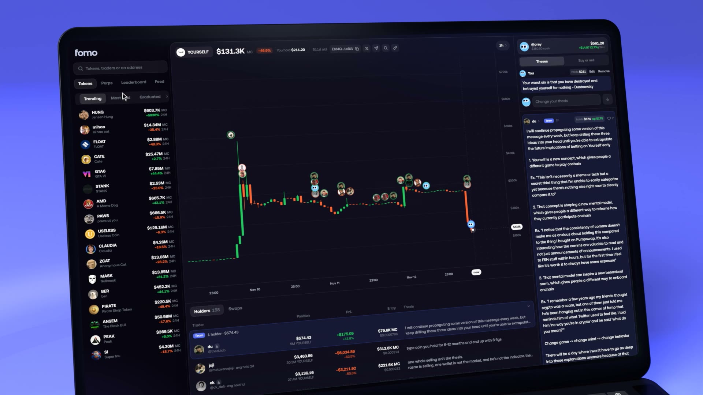
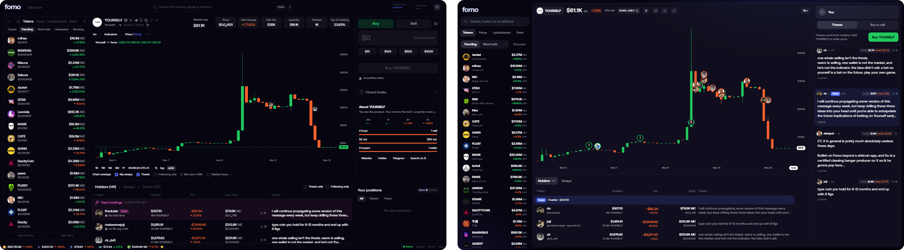
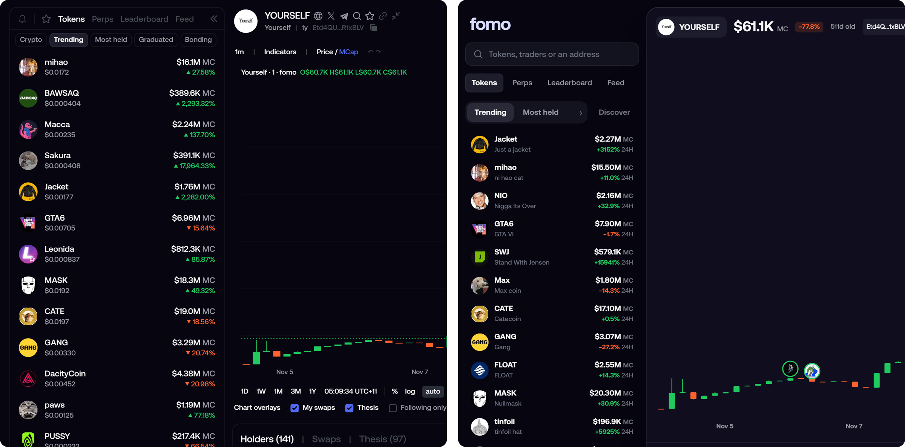
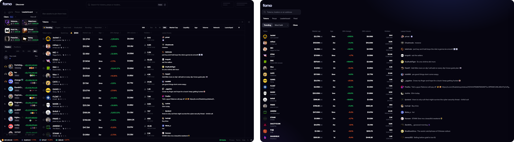
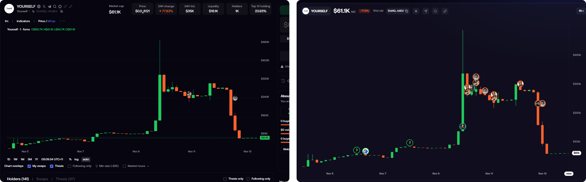
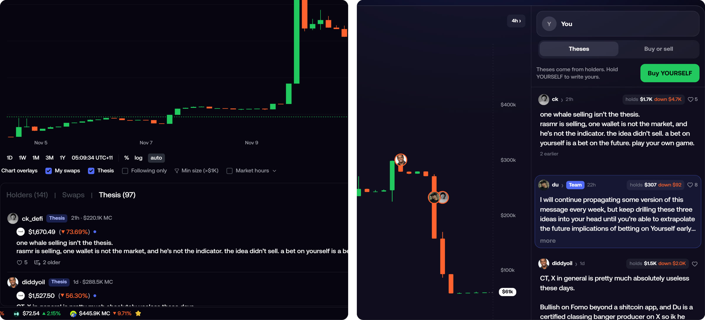
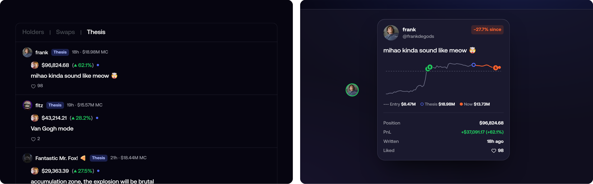
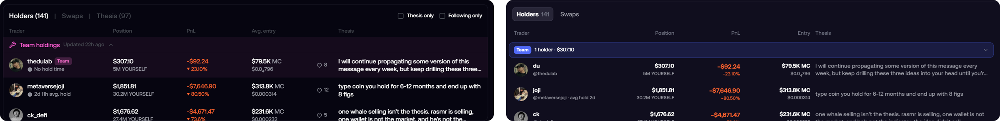
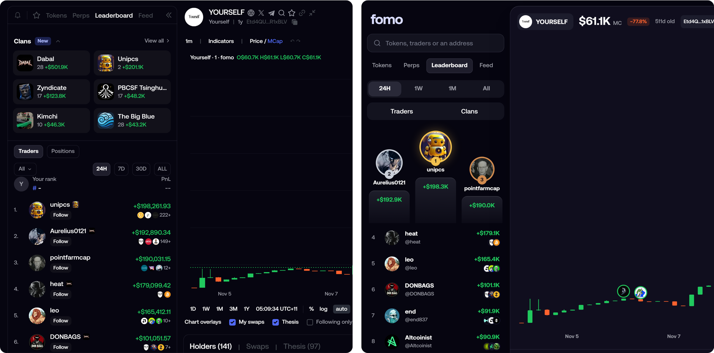
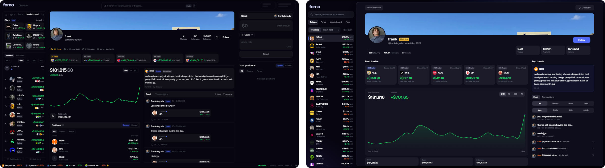

# FOMO web, reimagined

[](media/fomo-web-reimagined.mp4)

An unofficial concept redesign of [FOMO](https://fomo.family)'s web app, by [@whytrade2027](https://x.com/whytrade2027). FOMO is a social trading app: tokens, traders who write a "thesis" on what they hold, a leaderboard, a feed, profiles. Its web app today lays those parts out as panels side by side. This concept keeps every one of them and rearranges them around one chart, so the people and what they said sit on the price itself. It borrows the interaction style of drawdown, a chart-first trading app by the same author.

This repo is a small kit of the React components that carry the idea, with a sample of real FOMO data to render them. It is not an app to run against FOMO. Nothing here signs in, reads FOMO, or trades.

The write-up: [xbt.family/fomo](https://xbt.family/fomo).

## Current FOMO vs this concept

Each area below says what FOMO's web app does today, what the concept does instead, and which component shows it. The images are side by side comparisons.

### Layout



**Now.** A top bar, a resizable discovery panel on the left, a centre panel, a "Your positions" panel on the right and a ticker along the bottom. Panels can be split into rows and columns.

**Concept.** One slim column on the left and one sheet of glass for the token: chart, theses beside it, holders under it. The top bar's search and the discovery panel fold into the column. Drag the column's edge left and it folds to a rail of pictures, so the chart gets the room; drag it right and it becomes Discover. Traders open as sheets over the room, not as new pages.

Component: `Room` (the whole screen), `Column`.

### Tokens and discovery



**Now.** The left panel lists tokens under Tokens (Crypto, Trending, Most held and more), one row each with market cap and the day's change. The full table lives on a separate Discover page.

**Concept.** The column's Tokens and Perps lists are the narrow view of Discover. Each row shows its market cap and the day's change. Pressing a row opens it on the chart and the row stays lit. One search box finds tokens and traders together. Pull the column wide and the same list becomes the whole table (below).

Component: `Column`.

### Discover



**Now.** FOMO's Discover is a page of its own with a table: tokens or perps, a list, filters, and columns for market cap, age, change, volume, holders and the latest thesis.

**Concept.** The same table is the column pulled wide, on the same sheet as the chart. Drag the column's right edge to the right and the Tokens list grows across the screen, the rows gaining columns as the width allows, in FOMO's order: token, market cap, age, 24H change, 24H volume, holders on FOMO (with the total under it), then the latest thesis with its writer. The chart's sheet slides out to the right by as much. Let go past halfway and it springs open; before halfway it springs back. The word at the end of the list strip does the same by click: "Discover", and "Close" when wide. Rows keep their place, so the token you were on is still lit. Every figure's head sorts on click (highest, lowest, then FOMO's order). A row opens on the chart and the column springs back; a row's thesis opens the token with that thesis picked out in the rail. Perps widen the same way: price, 24H change, 24H volume, open interest, and funding an hour with who pays whom.

Component: `Column` (the rows and heads are in `ColumnWide`; `Room` slides the sheet). Perp rows press only when you pass `onPerp`, since the kit has no perp chart.

### Token page



**Now.** A header of stats, a TradingView chart with optional avatar overlays, and tabs under it for Holders, Swaps and Theses. Buy and sell sit in a panel on the right.

**Concept.** The chart is the page. The header is one row: the token, its market cap, the day's change, its age, its address to copy, a search for it on X and a link to copy. Each thesis stands on the candle it was written on, as the writer's face, ringed green if they are up and orange if they are down. Faces stack up from the candle's high, biggest position nearest the candle, and past five a stack shows a count. Theses from positions under $100 stay in the rail only.

Component: `TokenHeader`, `CandleChart`.

### Theses



**Now.** A Thesis tab under the chart, sortable, read like a table.

**Concept.** The theses run beside the chart like a chat, newest first. Each trader's latest stands for them, with "2 earlier" to open what they said before. Each one says what the writer holds now and whether it is up or down, and a rank tag shows if they are on the leaderboard. The token's own team is pinned at the top. Your own thesis is written in the box at the top. Hearts fill and count when pressed.

Component: `ThesisRail`.

### Thesis card



**Now.** A thesis is text in a row, with the author's position and PnL beside it.

**Concept.** A face on the chart, or the words in the rail, opens a card that grows out of the face. It has the words (cut near four lines, "more" for the rest), a small line of the price with where the writer got in, where they wrote it and where it is now (Entry, Thesis, Now), their buys and sells as B and S bubbles, and the figures: holds, position, PnL, when it was written, likes. The level it was written at is drawn across the chart while it is open. The card can be dragged anywhere.

Component: `ThesisCard` (opened by `CandleChart`).

### Holders



**Now.** A Holders tab: trader, average hold time, position, PnL, average entry, their thesis, clan.

**Concept.** The same columns under the chart, each figure with what it is made of under it (a position in dollars over the token amount). The token's team is pinned at the top as one group that folds, with its total. A holder's thesis sits beside their numbers and opens on its candle. Swaps are the second tab.

Component: `Holders`.

### Leaderboard



**Now.** A strip of clans, a Traders and Positions toggle, filters, timeframes and a long list of rows with Follow buttons.

**Concept.** One face of the column. Pick the span (24H, 1W, 1M, All) and Traders or Clans. The top three stand on a podium, first in the middle and tallest, in gold, silver and bronze. Everyone else follows in rows with what they made and their top holdings. A clan opens in place to its traders on the board.

Component: `Leaderboard`.

### Profiles



**Now.** A full profile page: banner, stats, best trades, portfolio chart, positions, a pinned thesis and a feed.

**Concept.** A trader opens as a sheet that grows out of whatever was pressed: a face, a holder row, a podium place. It shows who they are, what they made on each leaderboard span, their biggest holdings, their theses and their feed posts. Expand turns it into a full page over the room, and collapse folds it back, without leaving the token. A thesis on the page opens on its token's chart. The portfolio chart and best trades are not in the kit, because the sample does not carry them.

Component: `ProfileSheet`, `ProfilePage`.

## Using a component

The components are plain React (19), Tailwind CSS (v4) and [motion](https://motion.dev). They take data as props and read nothing themselves. The shapes are in `src/types.ts`.

```tsx
import { useState } from "react";
import { CandleChart, ThesisRail, type Room } from "./src";
import "./src/styles.css";

function TokenRoom({ room }: { room: Room }) {
  const [open, setOpen] = useState<string | null>(null);
  return (
    <div className="flex h-dvh">
      <CandleChart room={room} open={open} onOpen={setOpen} />
      <ThesisRail room={room} open={open} onOpen={setOpen} you={{ id: "me", name: "You", avatar: null }} />
    </div>
  );
}
```

A `Room` is a token, its candles, its theses (each with its author), its holders and its swaps. Times are read against the clock, or against `NowContext` if you set it, which is what the sample does so "2h" means two hours before it was captured.

To look at everything together:

```
npm install
npm run dev
```

That opens a preview of `Room` with the sample data. It is a way to look at the components, not a product.

## What's in here

```
src/
  Room.tsx          the whole screen, as an example of how the parts fit
  Column.tsx        left column: search, Tokens, Perps, Leaderboard, Feed; folds to a rail, pulls wide into Discover
  ColumnWide.tsx    Discover's rows, column heads and sorting
  Leaderboard.tsx   spans, podium, rows, clans
  Feed.tsx          trades and theses as they come in
  TokenHeader.tsx   the token's one-row header
  CandleChart.tsx   SVG candles with traders' faces on the candles they wrote on
  ThesisCard.tsx    the card a face opens, with the Entry, Thesis, Now line
  ThesisRail.tsx    theses beside the chart, your box at the top
  Holders.tsx       holders with the team pinned, and swaps
  Profile.tsx       a trader as a sheet, and as a full page
  parts.tsx         faces, logos, tabs, hearts, rank and stake tags
  types.ts          the data shapes
  lib/              formatting, a class name helper, motion settings
  styles.css        FOMO's palette, the glass, the type
data/
  fomo-sample.json  the sample
  sample.ts         turns the sample into the shapes above
preview/            the small page `npm run dev` shows
media/              the video, its poster, previews and comparisons
```

## The sample data

`data/fomo-sample.json` is real public data as FOMO's web app showed it, with nothing left out:

- Trending is FOMO's Discover table as read on 14 November 2026, in FOMO's order, with each token's age, holders, total holders and latest thesis.
- Everything else was read on 12 November 2026 at 08:16 UTC: six tokens (CHOO, mihao, updog, NIO, DACITYCOIN, FLOAT) with their candles, theses, holders and swaps, Most held, the leaderboard for four spans, and the feed. People appear with the public profile FOMO shows.
- The perps are the top 25 by a day's volume, read once from Hyperliquid's public info endpoint on 14 November 2026.

Nothing is made up. It is a snapshot and does not update. In the preview, a Trending token without a chart in the sample shows with its figures and thesis but does not open.

The type is Aeonik, FOMO's own, when the page has it loaded. The font files are not in this repo because it is a licensed typeface; without it the components fall back to [Geist](https://vercel.com/font), an open font. The wordmark is plain text.

## Not affiliated

This is an unofficial concept. It is not made by, affiliated with or endorsed by FOMO. FOMO's name belongs to its owners. Nothing in this repo connects to FOMO, signs in, or places a trade.

## Licence

MIT, by whytrade. See `LICENSE`. The licence covers the code here, not FOMO's name or the people and tokens in the sample.
